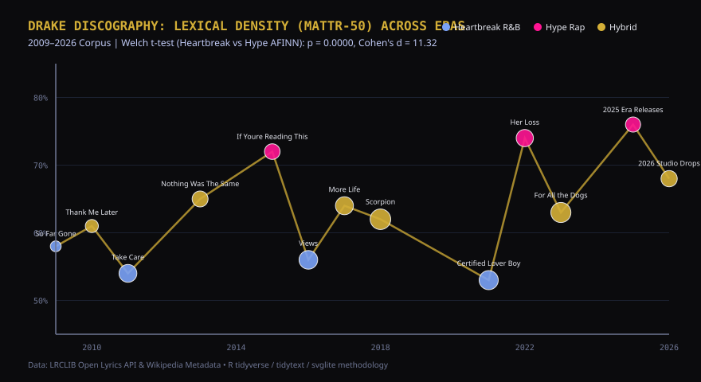

# DRAKE-LYRIC-NLP

> **Reproducible Statistical Text-Mining & Lexical Density Pipeline (2009–2026)**  
> *R Tidyverse • tidytext • Moving-Average TTR (MATTR-50) • Multi-Lexicon Valence • Welch Hypothesis Testing • svglite Dark Vector Graphics*

[](LICENSE)
[](https://www.r-project.org/)
[](https://python.org/)
[](https://lrclib.net/)

---

## Abstract & Research Questions

A common claim in contemporary hip-hop analysis is that stylistic evolution from early *Heartbreak R&B* (e.g. *So Far Gone*, *Take Care*) to modern *Hype Rap* releases reflects marked divergence in vocabulary diversity and emotional valence.

This project implements a reproducible statistical text-mining harness that:
1. Reconstructs full discography release metadata using `rvest` Wikipedia extraction.
2. Legally ingests synced and plain track lyrics via the public LRCLIB API with courteous rate-limiting and persistent disk caching.
3. Normalizes track-length variations through **Moving-Average Type-Token Ratio (MATTR-50)** across a 50-word sliding window.
4. Scores emotional polarity across multiple lexicons (Bing, AFINN, NRC with explicit many-to-many relationship mapping).
5. Validates cohort divergence via parametric (**Welch's Two-Sample t-test**) and non-parametric (**Wilcoxon Rank-Sum test**) hypothesis testing with Cohen's $d$ effect sizes.

---

## Mathematical Formulation

### 1. Moving-Average Type-Token Ratio (MATTR)

$$\text{MATTR}_L = \frac{1}{N - L + 1} \sum_{i=1}^{N - L + 1} \frac{V(w_i, \dots, w_{i + L - 1})}{L}$$

Where $N$ is total song token count, $L = 50$ is window width, and $V(\dots)$ denotes unique vocabulary count in the window.

### 2. Welch Two-Sample $t$-Test

$$t = \frac{\bar{X}_1 - \bar{X}_2}{\sqrt{\frac{s_1^2}{n_1} + \frac{s_2^2}{n_2}}}$$

Degrees of freedom $\nu$ are calculated using the Welch–Satterthwaite equation, eliminating the assumption of equal cohort variance.

---

## Output Visualization



---

## Execution

### R Pipeline:
```bash
Rscript drake_lyric_nlp.R
```

### Python Fallback Harness:
```bash
python drake_lyric_nlp.py
python -m unittest discover -s tests
```

---

## Author & License

- Researched & engineered by **Prajwal Jogi** ([@prajwal918](https://github.com/prajwal918))
- Released under the [MIT License](LICENSE).
